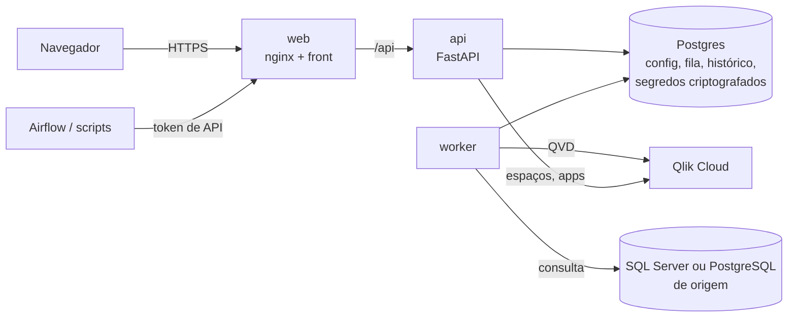

# LurkQVD

**Suas cargas QVD, em um só lugar.** O LurkQVD extrai dados do seu banco, gera os arquivos **QVD fora da Qlik**
e publica na **Qlik Cloud**, com agendamento, fila, histórico de cada execução e recarga dos apps.

Gerar o QVD fora da Qlik significa que só o arquivo final entra na cota de capacidade: a extração e a
transformação não consomem o seu tenant.

[](LICENSE)

---

## Sumário

- [O que ele faz](#o-que-ele-faz)
- [Como funciona](#como-funciona)
- [Instalação com Docker](#instalação-com-docker)
- [Primeiros passos na tela](#primeiros-passos-na-tela)
- [Integração com o Airflow (ou qualquer orquestrador)](#integração-com-o-airflow-ou-qualquer-orquestrador)
- [Configuração](#configuração)
- [Operação](#operação)
- [Segurança](#segurança)
- [Desenvolvimento](#desenvolvimento)
- [Ideias futuras](#ideias-futuras)
- [Contribuindo](#contribuindo)
- [Licença](#licença)

---

## O que ele faz

- **Cargas:** uma consulta SQL vira um QVD publicado numa pasta de um espaço da Qlik Cloud. O QVD é gerado
  em fluxo (lote a lote), então tabelas grandes não precisam caber na memória.
- **Agendamento** por cron (no fuso da instalação, `LURKQVD_FUSO`; padrão: horário de Brasília), execução manual ou pela API.
- **Fila com vários workers:** as execuções ficam no Postgres; quantos workers você subir dividem o trabalho.
- **Aplicações:** agrupam cargas que alimentam um app da Qlik. "Executar tudo" roda as cargas e, se todas
  derem certo, recarrega o app (com carga falhando, o app não é recarregado com dados pela metade).
- **Envio robusto para a Qlik:** arquivos grandes sobem em pedaços retomáveis; se o envio falhar, o QVD
  fica guardado e a próxima execução reenvia sem reler o banco.
- **Estimativa do tamanho do QVD** antes de criar a carga, sem varrer a tabela.
- **Acompanhamento:** progresso ao vivo, cancelamento, histórico com linhas, tamanho e duração de cada etapa,
  e a composição do QVD (quanto cada coluna pesa no arquivo).
- **Avisos por e-mail:** carga ou aplicação com erro, de volta ao normal, API key da Qlik perto de vencer.
- **Acessos:** login próprio, papéis (leitor, editor, admin), tokens de API para integrações e auditoria.
- **Tema claro e escuro.**

Bancos de origem: **SQL Server** e **PostgreSQL** (beta: testado contra um Postgres de teste, ainda com pouco uso
real; tipos sem equivalente no QVD, como uuid, json, arrays e bytea, viram texto). MySQL e Oracle estão previstos.

## Como funciona



- A **API** não executa cargas: ela registra o pedido na fila.
- O **worker** pega a próxima execução da fila, lê o banco de origem, gera o QVD e publica na Qlik Cloud.
- Tudo o que é sensível (API key da Qlik, senhas dos bancos e do SMTP) fica **criptografado no Postgres**.
  Nenhum serviço de nuvem externo é necessário além da própria Qlik Cloud.

## Instalação com Docker

### Requisitos

- Docker com Docker Compose v2 (`docker compose version`).
- Acesso, a partir do servidor, ao **banco de origem** (SQL Server ou PostgreSQL) e à **Qlik Cloud** (`https://<tenant>.qlikcloud.com`).
- Uma **API key da Qlik Cloud** de um usuário que possa gerenciar data files nos espaços de destino
  (e recarregar os apps, se for usar aplicações).
- Um **servidor de e-mail (SMTP)**: é por ele que os usuários recebem a senha de acesso.
- Cerca de 1 GB de RAM livre por worker para cargas comuns. A memória cresce com os **valores distintos**
  das colunas (~200 bytes cada), não com as linhas: uma coluna de ID único em 80 milhões de linhas pede ~15 GB.

### 1. Baixe e configure

```bash
git clone https://github.com/<sua-org>/lurkqvd.git
cd lurkqvd
cp .env.example .env
```

Preencha as duas variáveis obrigatórias do `.env`:

```bash
# senha do Postgres (só letras e números)
POSTGRES_PASSWORD=$(openssl rand -hex 24)

# chave que criptografa os segredos no banco
LURKQVD_FERNET_KEY=$(openssl rand -base64 32 | tr '+/' '-_')
```

> **Guarde uma cópia da `LURKQVD_FERNET_KEY` fora do servidor** (num cofre de senhas). Sem ela, a API key
> da Qlik e as senhas das fontes e do SMTP não podem ser lidas e precisarão ser cadastradas de novo.

### 2. Suba

Com as imagens publicadas (mais rápido, nada é compilado na máquina), informe no `.env` a imagem e a versão
(a lista de versões e o que mudou em cada uma estão nos [releases](../../releases) e no [CHANGELOG](CHANGELOG.md)):

```bash
LURKQVD_IMAGEM=ghcr.io/<sua-org>/lurkqvd
LURKQVD_VERSAO=0.1.0
```

```bash
docker compose pull
docker compose up -d
```

Ou compile a partir do código, sem preencher essas duas:

```bash
docker compose up -d --build
```

Na primeira subida, a API cria o banco (migrações) e o **usuário administrador**. Veja a senha inicial:

```bash
docker compose logs api | grep -A3 "admin padrão"
```

```
================================================================
  LurkQVD: admin padrão criado
  Login: admin
  Senha: Xk7q-9Pzm-Lw3t
```

### 3. Entre

Abra **http://localhost:8080**, entre com `admin` e a senha do log. No primeiro acesso, o LurkQVD pede o seu
nome, o seu e-mail (que passa a ser o seu login) e uma senha nova.

Para definir a senha inicial em vez de sorteá-la, use `LURKQVD_ADMIN_SENHA` no `.env` antes da primeira subida
(a troca no primeiro login continua obrigatória).

### Servidor sem acesso à internet (ou com firewall)

O build precisa baixar imagens do Docker Hub e pacotes do PyPI e do npm. Se o servidor não alcança esses
endereços, monte as imagens numa máquina com acesso (mesma arquitetura, normalmente x86_64) e leve-as prontas:

```bash
# na máquina com internet, dentro da pasta do projeto
docker compose build
docker save lurkqvd:local lurkqvd-web:local postgres:17 | gzip > lurkqvd-imagens.tar.gz

# leve o arquivo e a pasta do projeto para o servidor; lá:
gunzip -c lurkqvd-imagens.tar.gz | docker load
docker compose up -d          # sem --build: usa as imagens carregadas
```

Com SSH entre as duas máquinas dá para fazer em um passo:
`docker save lurkqvd:local lurkqvd-web:local postgres:17 | gzip | ssh usuario@servidor 'gunzip | docker load'`.

Para atualizar, repita: monte as imagens de novo, carregue no servidor e rode `docker compose up -d`.

## Primeiros passos na tela

Tudo fica em **Configurações** (ícone de engrenagem, só para administradores):

1. **Qlik Cloud** — informe o tenant (ex.: `minha-empresa.us`) e depois cole a API key. O LurkQVD testa a
   conexão antes de salvar e avisa antes da key vencer.
2. **Fontes de dados** — cadastre o banco de origem (SQL Server ou PostgreSQL) e marque como padrão. Use um **usuário só de leitura**.
3. **Notificações** — configure o SMTP. Sem ele não é possível cadastrar usuários.
4. **Usuários e acesso** — cadastre as pessoas (nome, e-mail e papel). Cada uma recebe uma senha temporária
   por e-mail e escolhe a sua no primeiro acesso.

Depois, em **Cargas › Nova carga**: nome, consulta SQL, destino (espaço e pasta da Qlik), agendamento e,
opcionalmente, a aplicação da qual a carga faz parte.

| Papel  | Pode |
| ------ | ---- |
| Leitor | acompanhar cargas e execuções |
| Editor | também executar e cancelar cargas e aplicações |
| Admin  | também criar e alterar cargas, pastas, aplicações, configurações e acessos |

## Integração com o Airflow (ou qualquer orquestrador)

Crie um token em **Configurações › API do LurkQVD** (permissão "Executar"). O token aparece uma única vez.

```bash
# 1. disparar: responde na hora (202) com o execucao_id; 409 = já estava na fila (traz o id dela)
curl -X POST "https://lurkqvd.minha-empresa.com/api/cargas/nome/fct_vendas/executar" \
     -H "Authorization: Bearer $LURKQVD_TOKEN"

# 2. acompanhar até "terminou": true (status: sucesso, erro ou cancelado)
curl "https://lurkqvd.minha-empresa.com/api/execucoes/123" \
     -H "Authorization: Bearer $LURKQVD_TOKEN"
```

Também dá para disparar uma aplicação inteira: `POST /api/aplicacoes/nome/<nome>/executar`.
A tela de API traz uma DAG pronta (HttpOperator + HttpSensor) para cada carga. A documentação interativa
de todas as rotas fica em `/api/docs`.

## Configuração

Tudo pelo `.env` (veja os comentários em [`.env.example`](.env.example)). O restante se configura pela tela.

| Variável | Padrão | Para quê |
| -------- | ------ | -------- |
| `POSTGRES_PASSWORD` | — (obrigatória) | senha do Postgres do docker compose |
| `LURKQVD_FERNET_KEY` | — (obrigatória) | chave dos segredos; várias separadas por vírgula = rotação |
| `LURKQVD_PORTA` | `8080` | porta do LurkQVD na máquina |
| `LURKQVD_IMAGEM` | `lurkqvd` | imagem da API e do worker (o front usa a mesma com `-web`); ex.: `ghcr.io/<sua-org>/lurkqvd` |
| `LURKQVD_VERSAO` | `local` | versão das imagens; `local` = compilada com `--build` |
| `LURKQVD_URL_APP` | `http://localhost:8080` | endereço público, usado nos links dos e-mails |
| `LURKQVD_ADMIN_SENHA` | sorteada | senha inicial do admin padrão |
| `LURKQVD_QLIK_TENANT` | vazio | tenant sugerido na primeira configuração |
| `LURKQVD_FUSO` | `America/Sao_Paulo` | fuso dos agendamentos, dos e-mails e do gráfico por dia (nome IANA, ex.: `Europe/Lisbon`, `UTC`) |
| `LURKQVD_DOCS` | `1` | `0` esconde a documentação interativa da API |
| `LURKQVD_SESSAO_INATIVA_H` | `12` | horas sem uso até a sessão expirar |
| `LURKQVD_SESSAO_MAX_DIAS` | `7` | duração máxima de uma sessão |
| `LURKQVD_MOTOR_LEITURA` | `odbc` | motor padrão das fontes: `odbc`, `arrow-odbc` ou `connectorx` |
| `LURKQVD_LOTES_ANTECIPADOS` | `2` | lotes lidos à frente enquanto o anterior vira QVD; `0` = em sequência |
| `LURKQVD_BUFFER_LEITURA_MB` | `128` | teto do buffer do motor `arrow-odbc` (reservado em dobro); maior não acelera, só gasta memória |
| `LURKQVD_LIMITE_MEMORIA_PCT` | `75` | memória das cargas (% da RAM ou do limite do container), sozinhas ou somadas |
| `LURKQVD_MEMORIA_SEM_HISTORICO_MB` | `1024` | reserva de uma carga que ainda não rodou |
| `LURKQVD_ESPERA_MAX_MIN` | `15` | depois disso esperando memória, uma carga não é mais ultrapassada |
| `LURKQVD_MAQUINA` | `servidor` | workers com o mesmo nome dividem a mesma RAM; um nome por máquina |
| `LURKQVD_LIMITE_ENVIO_DIRETO_MB` | `500` | acima disso, o upload para a Qlik é em pedaços retomáveis |

## Operação

### Atualizar

Leia no [CHANGELOG](CHANGELOG.md) o que muda entre a sua versão (no menu do usuário, ou em `/api/health`) e a nova.
Com as imagens publicadas, troque `LURKQVD_VERSAO` no `.env` e:

```bash
git pull                # docker-compose.yml e .env.example da versão nova
docker compose pull
docker compose up -d
```

Compilando a partir do código:

```bash
git pull
docker compose up -d --build
```

As migrações do banco rodam sozinhas na subida (só as que faltam). Para voltar de versão, troque `LURKQVD_VERSAO`
de novo, mas só se a versão nova não tiver criado migrações: elas não são desfeitas (o CHANGELOG avisa).

### Mais workers

```bash
docker compose up -d --scale worker=3
```

Cada worker executa uma carga por vez; as execuções nunca são pegas por dois ao mesmo tempo.

Os workers da mesma máquina dividem a RAM dela sem precisar de ajuste: cada execução grava quanto de memória
usou, e um worker só pega uma carga se o que ela usou nas últimas vezes couber no que os outros ainda não
estão usando. Uma carga que não cabe espera, e as menores passam na frente por até `LURKQVD_ESPERA_MAX_MIN`;
depois disso, a fila espera a máquina liberar memória para ela. Então dá para subir mais workers do que a
memória comportaria rodando todas as maiores juntas: o que limita é o processador (cerca de 1 núcleo por
carga) e o banco de origem.

Com workers em várias máquinas, dê a cada máquina o seu `LURKQVD_MAQUINA`.

### Backup

Faça backup do volume do Postgres **e** guarde a `LURKQVD_FERNET_KEY`:

```bash
docker compose exec -T postgres pg_dump -U lurkqvd -Fc lurkqvd > lurkqvd-$(date +%F).dump
```

Para restaurar num banco novo: `docker compose exec -T postgres pg_restore -U lurkqvd -d lurkqvd --clean < arquivo.dump`.

### Perdi o acesso de administrador

```bash
docker compose exec api lurkqvd cli definir-senha <email-do-admin>
```

Mostra uma senha temporária; no próximo login é pedida uma nova.

### HTTPS

O serviço `web` fala HTTP na porta 8080. Em produção, coloque na frente um proxy com certificado. Exemplo com
[Caddy](https://caddyserver.com) (certificado automático):

```
lurkqvd.minha-empresa.com {
    reverse_proxy 127.0.0.1:8080
}
```

E defina `LURKQVD_URL_APP=https://lurkqvd.minha-empresa.com` no `.env`.

### Logs

```bash
docker compose logs -f api worker
```

## Segurança

Resumo do que o LurkQVD faz para proteger os dados e as recomendações para produção estão em
[SECURITY.md](SECURITY.md), junto com **como reportar uma vulnerabilidade** (de forma privada).

## Desenvolvimento

Requisitos: Python 3.12, Node 22, Docker e o [ODBC Driver 18 for SQL Server](https://learn.microsoft.com/sql/connect/odbc/download-odbc-driver-for-sql-server).

```bash
# banco de desenvolvimento (127.0.0.1:5433)
docker compose -f docker-compose.dev.yml up -d

# backend
python -m venv .venv
.venv/bin/pip install -r requirements-dev.txt          # Windows: .venv\Scripts\pip
cp .env.example .env                                    # defina LURKQVD_FERNET_KEY e LURKQVD_CORS=http://localhost:5173
.venv/bin/python -m src.lurkqvd.cli migrar
.venv/bin/uvicorn src.lurkqvd.api.main:app --reload    # http://localhost:8000/docs
.venv/bin/python -m src.lurkqvd.worker                 # em outro terminal

# front
cd front && npm install && npm run dev                 # http://localhost:5173
```

Testes e verificações (os testes de banco criam um Postgres descartável no servidor do compose de dev):

```bash
.venv/bin/python -m pytest
cd front && npm run lint && npm run build
```

Estrutura:

```
src/lurkqvd/
  api/          rotas (FastAPI): main, acesso, aplicacoes, notificacoes, auth
  repository/   todo o SQL do banco de metadados
  pipeline/     geração do QVD (em fluxo), estimativa de tamanho, trava de memória
  clients/      cliente da API da Qlik Cloud
  config/       fontes de dados, segredos, Qlik, SMTP
  worker.py     fila, agendamento, aplicações e avisos
  migracoes.py  migrações do banco (db/migracoes)
front/          React + Vite + Tailwind; nginx/ para o Docker
db/migracoes/   NNN_descricao.sql, em ordem
scripts/        diagnóstico e medição contra bancos e Qlik reais
tests/          pytest
```

Mudanças de banco entram como um arquivo novo em `db/migracoes/` com o próximo número.

## Ideias futuras

Ainda não estão no plano de nenhuma versão; ficam aqui para discussão (abra uma issue se alguma te interessa).

- **Cargas incrementais.** Hoje toda execução relê a consulta inteira. O QVD não aceita acrescentar linhas
  (símbolos e índice mudam), então incremental seria gerar o QVD novo juntando o anterior, lido do disco, com só o
  que mudou no banco. Modos possíveis:
  - *janela móvel*: relê os últimos N dias de uma coluna de data e troca esse trecho no QVD anterior. Pega
    correções e exclusões dentro da janela e não exige nada da tabela;
  - *só acrescenta*: lê o que passou da maior marca (id ou data) da última execução com sucesso;
  - *por chave*: chave + coluna de alteração, substituindo as linhas com a mesma chave.

  Em qualquer modo: a marca só avança depois de publicar, carga completa periódica para corrigir desvios, e volta
  para a completa quando a consulta ou as colunas mudam. Alternativa sem juntar nada: um QVD por mês, regerando só
  o atual (exige `LOAD * FROM [tabela_*.qvd]` no app).
- **Outras fontes de dados**: MySQL e Oracle (a estrutura de drivers em `config/fontes.py` já prevê).

## Contribuindo

Contribuições são bem-vindas: relatos de bug, ideias, documentação e código. Veja o
[CONTRIBUTING.md](CONTRIBUTING.md) para preparar o ambiente, os padrões do projeto e como abrir um pull request.
Ao participar, siga o [Código de Conduta](CODE_OF_CONDUCT.md).

## Licença

[Apache License 2.0](LICENSE).

O LurkQVD é um projeto independente, sem vínculo com a Qlik, nem patrocinado, endossado ou certificado por ela.
Qlik, Qlik Cloud, Qlik Sense, QlikView e QVD são marcas da QlikTech International AB, citadas só para dizer com
que produtos e formato o LurkQVD funciona.
